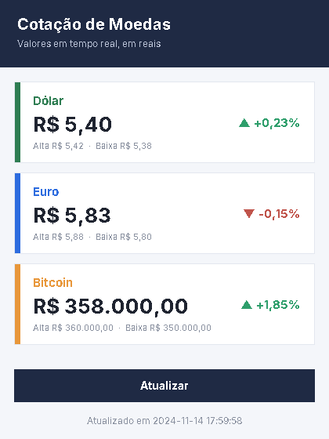

# 💱 Cotação de Moedas

Aplicativo em **Java** com Swing que busca as **cotações do Dólar, Euro e Bitcoin em tempo real** (em reais) direto da internet. Um projeto que mostra como consumir uma **API pública** e tratar dados em **JSON** — sem nenhuma biblioteca externa.




## O que ele faz

- 🌐 Busca cotações **ao vivo** de Dólar, Euro e Bitcoin
- 💰 Mostra o valor em reais já formatado (ex.: `R$ 5,40`)
- 📈 Exibe a **variação do dia** em verde (subiu ▲) ou vermelho (caiu ▼)
- 🔁 Botão **Atualizar** para pegar os valores mais recentes
- 🧵 A busca roda em **segundo plano**, então a janela nunca trava
- ⏱️ Mostra o horário da última atualização

## De onde vem os dados

As cotações vêm da [**AwesomeAPI**](https://docs.awesomeapi.com.br/api-de-moedas) — uma API brasileira, **gratuita e sem necessidade de cadastro ou chave**. O app chama o endereço:

```
https://economia.awesomeapi.com.br/last/USD-BRL,EUR-BRL,BTC-BRL
```

> ⚠️ Por usar dados da internet, o app precisa de **conexão** para funcionar.

## Como executar

Requer o **Java (JDK 17 ou superior)** instalado.

```bash
git clone https://github.com/SEU-USUARIO/cotacao-moedas.git
cd cotacao-moedas
javac *.java
java AppCotacao
```

## Como o projeto está organizado

O código é dividido em três partes, cada uma com sua responsabilidade (boa prática de organização):

| Arquivo | Responsabilidade |
|---|---|
| `Moeda.java` | O **modelo**: guarda os dados de uma cotação (valor, variação, alta, baixa) |
| `CotacaoService.java` | O **serviço**: conversa com a internet (HTTP) e lê o JSON da API |
| `AppCotacao.java` | A **tela**: mostra os cartões e o botão, sem saber nada de internet |

Essa separação (modelo / serviço / interface) deixa o código mais fácil de entender, testar e manter.

## Tecnologias

Java 21 · Swing (interface) · `java.net.http.HttpClient` (requisições HTTP) · `SwingWorker` (tarefa em segundo plano) · leitura de JSON feita na mão (**sem bibliotecas externas**).


---

Feito com ☕ e Java — consumindo dados reais da web.


